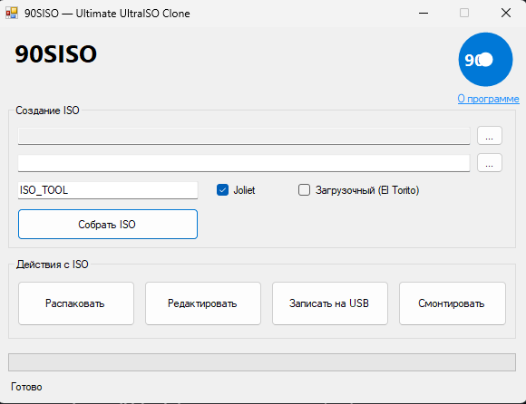

# 💿 90SISO

Бесплатный открытый аналог UltraISO на C# WinForms. Без подписок, без триалов, без «купите Pro чтобы записать на USB».

Писал для себя, чтобы не платить за UltraISO и заодно разобраться, как ISO устроен изнутри. Работает, но местами сырой — см. раздел «Чего пока нет».

## Что умеет

- **Сборка ISO из папки** — с поддержкой Joliet (длинные имена не превращаются в `FILE~1.TXT`) и меток томов.
- **Загрузочные образы (El Torito)** — реально вшивает boot-сектор, который подхватывает BIOS. Проверено на кастомном секторе на NASM.
- **Редактирование содержимого** — распаковка во временную папку, правка, пересборка.
- **Запись на USB** — побайтовая запись на физический диск с прогресс-баром. ⚠️ Диск будет стёрт.
- **Монтирование ISO** — через PowerShell `Mount-DiskImage`, стандартными средствами Windows.

## Сборка

1. Открой `IsoTool.sln` в Visual Studio 2019 или новее.
2. Поставь **.NET Framework 4.8.1 Developer Pack** — без него не соберётся.
3. Восстанови NuGet-пакеты. Зависимости: `LTRData.DiscUtils.Iso9660`, `LTRData.DiscUtils.Udf`.
4. F6.

Для записи на USB нужны права администратора — прописано в `app.manifest`, UAC спросит сам.

## Тестовый загрузочный образ

В релизах лежит `installer_game.bin` — 512-байтный boot-сектор на ассемблере. Снаружи прикидывается установщиком Windows, а на деле запускает мини-игру «Угадай число». Делал поржать и заодно проверить, что El Torito работает не только на бумаге.

Как проверить:

1. Выбери папку.
2. Поставь галочку **«Загрузочный (El Torito)»**.
3. Укажи путь к `.bin`.
4. Собери ISO.
5. Запусти в VirtualBox или QEMU.

## Чего пока нет

Не буду делать вид, что это полноценная замена UltraISO:

- UDF только на чтение, записи нет.
- Нет drag-and-drop файлов в GUI.
- Нет поддержки DVD-Video и прочей экзотики.

Если чего-то не хватает — открывай issue, посмотрю. PR тоже приветствуются.

## Лицензия

MIT — делай что хочешь.
